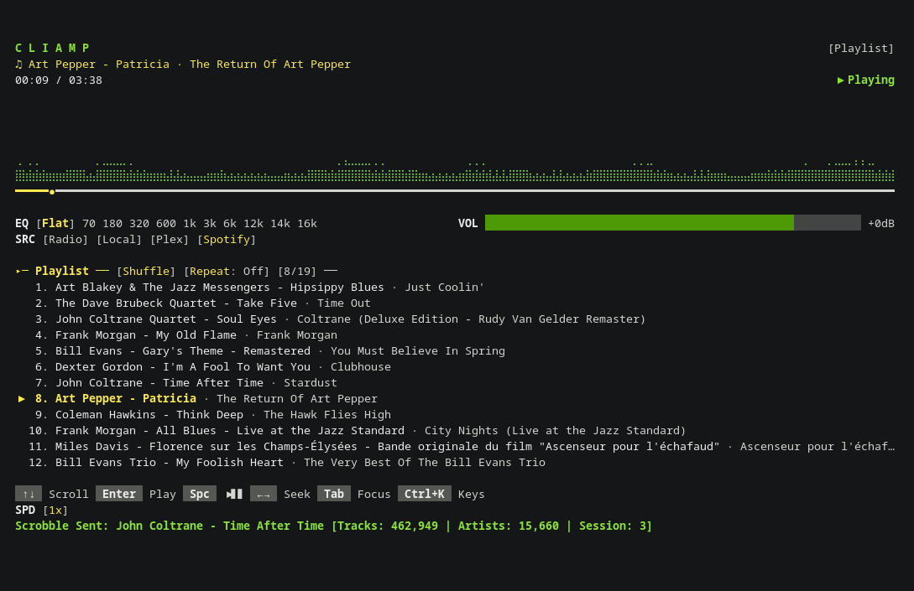

# cliamp-lastfm

A Last.fm scrobbling plugin for [cliamp](https://github.com/bjarneo/cliamp).

Automatically sends your currently playing music to Last.fm with support for Now Playing updates, configurable scrobble thresholds, track loving/unloving, playback tracking, session statistics, and multiple operating modes.



---

## ✨ Features

- 🎵 Automatic Last.fm scrobbling
- ▶️ Last.fm Now Playing updates
- ⏱️ Configurable scrobble thresholds
- 🕐 Actual playback-time tracking
- ⏸️ Pause/resume-aware tracking
- ⏩ Seek-aware playback handling
- 📊 Last.fm and session statistics
- ❤️ Love / unlove tracks directly from cliamp
- 💗 Loved-track detection
- 🔄 Duplicate-scrobble protection
- ⌨️ Manual scrobbling
- 💤 Silent mode
- 🚫 Fully disabled mode
- 🔐 Browser-based Last.fm authentication
- 🔒 HTTPS communication with Last.fm
- 🛠️ Automated setup script

---

<details>
<summary><strong>🚀 Getting Started</strong></summary>

### Prerequisites

The plugin requires:

- [cliamp](https://github.com/bjarneo/cliamp)
- A Last.fm account
- A Last.fm API application

The automated setup script requires `bash`, `curl`, `jq`, and a web browser.

```bash
# macOS
brew install jq

# Debian / Ubuntu
sudo apt install jq
```

### Install

```bash
cliamp plugins install tetsuo76/cliamp-lastfm
```

### Get Last.fm API credentials

Create a Last.fm API application at [last.fm/api/account/create](https://www.last.fm/api/account/create). You'll need the **API Key** and **API Secret** — no callback URL is required for this plugin's auth flow.

### Run the setup script

From the plugin directory:

```bash
./setup-lastfm.sh
```

The script opens the Last.fm registration page, collects your API key/secret/username, requests an authorization token, opens the Last.fm authorization page, and retrieves a session key once you approve the application. Credentials are saved to your cliamp configuration. You only need to do this once.

### Restart cliamp

```bash
cliamp
```

The plugin will automatically begin tracking playback and communicating with Last.fm.

</details>

---

<details>
<summary><strong>⚙️ Configuration</strong></summary>

Config lives in `~/.config/cliamp/config.toml`:

```toml
[plugins.cliamp-lastfm]

# Last.fm authentication
api_key = "YOUR_API_KEY"
api_secret = "YOUR_API_SECRET"
session_key = "YOUR_SESSION_KEY"
username = "YOUR_LASTFM_USERNAME"

# Scrobbling
scrobble_mode = "played"
scrobble_seconds = 120

# Now Playing
now_playing = true

# Notifications
message_duration = 10
```

Keep your API Secret and Session Key private. Only configure the threshold options required by the selected scrobble mode.

### Scrobble modes

The plugin supports configurable scrobble timing instead of requiring playback to reach the end of a track.

| Mode | Config | Behavior |
| --- | --- | --- |
| `played` (recommended) | `scrobble_seconds = 120` | Scrobbles after 120s of **actual playback**. Paused time doesn't count. |
| `percent` | `scrobble_percent = 50` | Scrobbles after reaching 50% of the track. |
| `seconds` | `scrobble_seconds = 120` | Scrobbles after reaching a fixed playback position (2:00 in). |
| `lastfm` | `scrobble_max_seconds = 240` | Traditional Last.fm rule: ~50% played, or the max threshold — whichever comes first. |

`played` mode example — pausing doesn't accumulate listening time:

```text
00:00  Play
01:00  Pause          (10 minutes paused, doesn't count)
01:00  Resume
02:00  Scrobble
```

### Now Playing

Independent of the scrobble threshold — updates Last.fm's **Now Playing** status as soon as a track starts.

```toml
now_playing = true   # or false to disable
```

### Notifications

```toml
message_duration = 10   # seconds notifications stay visible; lower for less intrusive
```

</details>

---

<details>
<summary><strong>🎮 Usage</strong></summary>

### Keybindings

| Key      | Action                           |
| -------- | --------------------------------- |
| `*`      | Love / unlove current track      |
| `&`      | Toggle Last.fm operating mode    |
| `Ctrl+L` | Manually scrobble current track  |

> `S` is intentionally **not** used for manual scrobbling because `S` is already assigned by cliamp.

**Love / Unlove** (`*`) — toggles the loved status of the current track and detects/displays whether it's already loved.

**Manual scrobble** (`Ctrl+L`) — useful for long mixes, live recordings, radio streams, podcasts, tracks with unusual lengths, recovering from a failed automatic scrobble, or testing. Protected against submitting the same playback session twice.

### Operating modes

Press `&` to cycle: `Normal → Silent → Off → Normal`

| Feature       | Normal    | Silent     | Off        |
| ------------- | --------- | ---------- | ---------- |
| Scrobbling    | ✅ Enabled | ✅ Enabled  | ❌ Disabled |
| Now Playing   | ✅ Enabled | ✅ Enabled  | ❌ Disabled |
| Last.fm API   | ✅ Enabled | ✅ Enabled  | ❌ Disabled |
| Notifications | ✅ Enabled | ❌ Disabled | ❌ Disabled |
| Love / Unlove | ✅ Enabled | ✅ Enabled  | ❌ Disabled |

Silent mode keeps Last.fm tracking active without notifications interrupting playback. Off disables Last.fm integration entirely.

### Playback tracking

The plugin tracks actual playback rather than trusting the raw track position, so it properly handles play, pause, resume, track changes, seeking, stopping, and manual scrobbling:

```text
Played time = time actually spent listening   (not: current playback position)
```

This stops seeking forward or leaving a track paused from artificially satisfying the scrobble threshold.

### Statistics

Successful scrobbles can display total track plays, total artist count, loved track count, current track play count, and current cliamp session scrobbles:

```text
✓ Scrobbled: Artist - Song [2:03 played]
```

</details>

---

<details>
<summary><strong>🛠️ Maintenance & Troubleshooting</strong></summary>

### Updating

Update through the normal cliamp plugin update/reinstall process. If cliamp reports the plugin as untrusted afterward:

```bash
cliamp plugins trust cliamp-lastfm
cliamp plugins list   # verify it shows as trusted
```

Restart cliamp after updating.

### Compatibility

Tested cliamp providers: local files, Radio, Spotify, Plex. Other providers should work as long as they expose the playback and track information the plugin needs.

### Migrating from `[plugins.lastfm]`

Older configs used `[plugins.lastfm]`. Rename that section to `[plugins.cliamp-lastfm]`.

### Troubleshooting

**Plugin shows as untrusted** — run `cliamp plugins trust cliamp-lastfm`, then `cliamp plugins list`.

**Not scrobbling** — check the config exists:

```bash
grep -A10 '\[plugins.cliamp-lastfm\]' ~/.config/cliamp/config.toml
```

You should see `api_key`, `api_secret`, `session_key`, and `username` all set. If `session_key` is missing or invalid, rerun `./setup-lastfm.sh` and restart cliamp.

**Now Playing works but scrobbling doesn't** — check your threshold (`scrobble_mode`/`scrobble_seconds`). Remember `played` mode measures actual listening time: pausing and seeking forward don't count toward it.

**Want tracks scrobbled sooner** — lower the threshold, e.g. `scrobble_seconds = 60`.

**Want traditional Last.fm behavior** — use `scrobble_mode = "lastfm"` with `scrobble_max_seconds = 240`.

**Seeking through a track scrobbles it too early** — shouldn't happen in `played` mode, since it tracks actual listening time rather than trusting playback position.

</details>

---

<details>
<summary><strong>📜 Release Notes</strong></summary>

### v2.0.0

**Added**

- Configurable scrobble thresholds
- Actual played-time tracking
- Percentage-based scrobbling
- Fixed playback-position scrobbling
- Last.fm-style scrobble threshold
- Last.fm Now Playing support
- Manual scrobbling
- `Ctrl+L` manual scrobble keybinding
- Pause/resume-aware playback tracking
- Seek-aware playback handling
- Duplicate-scrobble protection
- Configurable notification duration
- Improved Last.fm API handling
- Improved error handling
- Improved scrobble status reporting

**Changed**

- Scrobbling no longer depends exclusively on reaching the end of a track
- Playback tracking now accounts for actual listening time
- Paused playback no longer counts toward played-time thresholds
- Seeking no longer artificially increases played time
- Manual scrobbling moved to `Ctrl+L`
- Last.fm API communication uses HTTPS
- Plugin version updated to `2.0.0`

**Removed**

- End-of-track-only scrobbling behavior
- `S` manual scrobble keybinding due to cliamp keybinding conflict
- HTTP Last.fm API endpoint

**Preserved**

- Last.fm OAuth authentication
- Automated setup script
- Love / unlove functionality
- Loved-track detection
- Session statistics
- Normal / Silent / Off operating modes
- `*` love/unlove keybinding
- `&` mode toggle keybinding

### v1.7.0

- Added automated Last.fm setup script
- Added automatic Last.fm API registration workflow
- Added browser-based OAuth authorization
- Added automatic credential saving
- Added setup documentation

</details>

---

## 📄 License

This project is open source. See the [LICENSE](LICENSE) file for details.

## 🤝 Contributing

Contributions are welcome! Please feel free to submit a Pull Request.

## 🙏 Acknowledgments

- [cliamp](https://github.com/bjarneo/cliamp) – The terminal audio player this plugin is built for
- [Last.fm API](https://www.last.fm/api) – Scrobbling and Now Playing services
